  

  

# 🏆 Awesome Employee Recognition &amp; Gamification

**A curated index of top-tier SaaS platforms, self-hostable open-source frameworks, kudos engines, PBML mechanisms, and employee engagement tools.**

  <a href="#-sector-overview--market-dynamics">Sector Overview</a> •
  <a href="#-saashosted-platforms">SaaS Platforms</a> •
  <a href="#-open-source-github-projects">Open-Source Repositories</a> •
  <a href="#-how-to-contribute">How to Contribute</a> •
  <a href="#-support--community">Support</a> •
  <a href="#-star-history">Star History</a>

---

## 📌 Introduction

Building an organizational culture centered on continuous appreciation, motivation, and positive reinforcement directly impacts team retention and productivity. This repository tracks notable **SaaS platforms** and active **open-source projects** in the **Employee Recognition, Peer Kudos, and Gamification** ecosystem. 

Whether you are looking for an all-in-one corporate recognition suite (integrated with Slack, Microsoft Teams, and Amazon Business) or self-hosted, privacy-preserving microservices with points, badges, milestones, and leaderboards (PBML), this guide provides clear insights, verified pricing, and repository benchmarks.

---

## 🧭 Table of Contents

- [📊 Sector Overview & Market Dynamics](#-sector-overview--market-dynamics)
- [☁️ SaaS/Hosted Platforms](#-saashosted-platforms)
- [💻 Open-Source GitHub Projects](#-open-source-github-projects)
- [🛠️ Frameworks & Architecture Recommendations](#️-frameworks--architecture-recommendations)
- [🤝 How to Contribute](#-how-to-contribute)
- [💖 Support & Community](#-support--community)
- [⭐ Star History](#-star-history)
- [⚠️ Disclaimer](#️-disclaimer)

---

## 📊 Sector Overview & Market Dynamics

The global employee recognition and engagement software market is estimated at approximately **$20 billion to $40+ billion**, expanding at a compound annual growth rate (CAGR) of **6% to 9%**, accelerated by remote/hybrid team operations and executive focus on culture analytics.

* **Market Fragmentation:** The sector is **moderately fragmented** at the small-to-medium enterprise (SME) tier, sustained by agile point solutions, Slack-native kudos apps, and boutique reward programs.
* **Consolidation Pressures:** Enterprise demand for unified HRIS/HCM integrations, consolidated vendor billing, and zero-markup global fulfillment drives steady consolidation toward category leaders (e.g., Awardco, Workhuman) and Human Capital Management suites (e.g., Workday, Zoho CRM).

---

## ☁️ SaaS/Hosted Platforms

*Ranked in descending order by estimated company scale (valuation / annual revenue).*

| Product | Scale (Valuation / Revenue) | Description | Pricing (Starting) | Free Tier / Trial Limits |
|:---|:---|:---|:---|:---|
| **[Zoho Motivator / CRM Gamescope](https://www.zoho.com/motivator/)** | **~$12.5B** valuation / **~$1.5B** revenue (FY25) | Sales performance tracking and gamification within Zoho CRM. Features KPI scorecards, competitive contests, and TV dashboards (standalone folded into Zoho CRM / CRM Plus). | Paid tiers from **$14/user/month** (Zoho CRM Standard, billed annually) or **$60/month** (legacy Motivator pack) | **Free forever plan**: up to 3 users (Zoho CRM) or 5 users (legacy Motivator); **15-day free trial** on paid editions |
| **[Awardco](https://www.awardco.com/)** | **$1B+** valuation / **~$75.2M** ARR | Enterprise recognition and rewards platform featuring deep Amazon Business integration and zero-markup reward redemption. | Starter bundles from **$3,000/year** (~$250/month) for small teams (up to 100 users) | **No free tier or trial**; guided demo via sales |
| **[Bonusly](https://bonus.ly/)** | **~$100M–$250M** valuation / **~$14M** ARR | Peer-to-peer kudos tied to company values with gift card catalogs and automated Bizy AI culture insights. | Core plan from **$3/user/month** (billed annually) or **$5/user/month** with Bizy AI | **Free forever plan**: up to 8 users with Slack/Teams integration; **30-day free trial** for Team/Org tiers |
| **[Motivosity](https://www.motivosity.com/)** | Bootstrapped / **~$16.9M** ARR | Culture and engagement hub featuring "Thanks Bucks", peer social recognition feed, and 1-on-1 manager coaching tools. | Base bundle from **$2/user/month** ($3,000 annual minimum commitment) | **No free tier or trial**; guided product walkthrough demo only |
| **[WorkTango](https://www.worktango.com/)** | Acquired by BI WORLDWIDE / **~$10M+** ARR est. | Holistic employee experience suite unifying peer-to-peer recognition, employee listening pulse surveys, and goal tracking. | Platform bundles from **$3/user/month** (subject to 12-month minimum contract) | **No free tier or trial**; custom enterprise demo and POC preview only |
| **[Kudos](https://www.kudos.com/)** | **~$17.7M** funding raised / **~$8.8M** ARR | Values-aligned corporate recognition platform featuring tiered appreciation levels, milestone celebrations, and multilingual support across 11 languages. | Base subscription from **$3.25/user/month** (annual contract required) | **No free tier or trial**; guided demo via sales |
| **[Guusto](https://www.guusto.com/)** | Bootstrapped / **~$6.6M** ARR | Modern recognition platform offering flexible merchant gift cards without per-item markup, popular across North America. | **$125/month** (Lite plan: 1 Sender + 250 Recipients) or **$4/sender/month + $0.70/recipient/month** (Essential plan) | **Free forever plan**: 1 user account for single-order gift card sending; no expiring trial needed |
| **[Matter](https://matterapp.com/)** | Bootstrapped / **~$1M** ARR | Slack and Microsoft Teams native recognition platform featuring customizable Kudos cards, celebratory coins, and Feedback Friday routines. | Basic plan from **$1/user/month** (billed annually) or **$2/user/month** (billed monthly) | **Free forever plan**: unlimited users for core kudos and Friday feedback; **14-day free trial** with full Pro access (no credit card required) |

---

## 💻 Open-Source GitHub Projects

*Ranked in descending order by GitHub stargazers count.*

| Project | GitHub_Stars | Tech Stack | Highlights & Description |
|:---|:---:|:---|:---|
| **[ActiDoo/gamification-engine](https://github.com/ActiDoo/gamification-engine)** |  | Python / REST API | **High-performance gamification rules engine (`gengine`).** Powers customizable points, achievement levels, time-based quests, and leaderboards via clean REST endpoints for arbitrary business applications. |
| **[Meeds-io/meeds](https://github.com/Meeds-io/meeds)** |  | Java / Vue.js / Docker | **Decentralized employee engagement and recognition platform.** Complete workspace suite featuring peer-to-peer kudos, automated engagement points, challenge management, and tokenized community rewards. |
| **[ngageoint/gamification-server](https://github.com/ngageoint/gamification-server)** |  | Python / Django | **Enterprise gamification and award server.** Supports Mozilla Open Badges standard, custom achievement triggers, event feeds, point ledgers, and multi-tenant organizational management. |
| **[mattjegan/django-gamification](https://github.com/mattjegan/django-gamification)** |  | Python / Django | **Pluggable Django gamification framework.** Easily unlocks badges, points, and unlockable achievements inside any Django-powered web portal or enterprise intranet. |
| **[trophyso/ui](https://github.com/trophyso/ui)** |  | TypeScript / React / Tailwind | **Pre-built UI components for gamification interfaces.** Provides open-source copy-paste React components for streaks, achievement cards, animated XP progress bars, and leaderboard displays. |
| **[isuru89/oasis](https://github.com/isuru89/oasis)** |  | Java | **Open-source PBML (Points, Badges, Milestones, Leaderboards) platform.** Designed with inspiration from Stack Overflow reputation models to power enterprise engagement, learning paths, and recognition. |
| **[pacoorozco/gamify-laravel](https://github.com/pacoorozco/gamify-laravel)** |  | PHP / Laravel | **Gamification package for Laravel applications.** Provides turnkey user badge awards, custom reputation point events, and level progression systems. |
| **[Pagepro/open-kudos](https://github.com/Pagepro/open-kudos)** |  | TypeScript / Node.js / MongoDB | **Open-source Slack recognition and gift bot.** Lets team members send peer kudos points via Slack, separates giveable vs spendable balances, and lets users redeem earned points for custom company prizes. |
| **[fvergaracl/GAME](https://github.com/fvergaracl/GAME)** |  | Python / FastAPI / PostgreSQL | **Goals And Motivation Engine.** Microservice backend orchestrating goal-driven motivation, points-to-coins conversion, and Keycloak authentication ready for Kubernetes deployment. |
| **[synyx/kudos](https://github.com/synyx/kudos)** |  | Java / TypeScript | **Lightweight appreciation card tool.** Create visual appreciation "Kudo" cards with custom templates, freehand drawing, image export, and an interactive meeting Presentation Mode. |
| **[dongitran/Good-Job](https://github.com/dongitran/Good-Job)** |  | NestJS / React / PostgreSQL / Redis | **Full-stack peer recognition & reward platform.** Features dual-balance wallets (monthly giveable + redeemable), core-value kudos, reward stock protection, real-time SSE stream, and 170+ E2E tests. |
| **[awpthorp/pizzabot](https://github.com/awpthorp/pizzabot)** |  | Next.js / PostgreSQL / Slack Bolt | **Slack-native peer appreciation bot.** Teammates award "pizzas" for great collaboration, featuring daily giving allowances, lifetime point totals, and automatic weekly leaderboards. |

---

## 🛠️ Frameworks & Architecture Recommendations

When deciding between commercial SaaS products and open-source self-hosted architectures:

1. **Self-Hosted Full Recognition Platform:** Use **[Good Job](https://github.com/dongitran/Good-Job)** or **[Meeds](https://github.com/Meeds-io/meeds)** if you require an out-of-the-box system with user wallets, point catalogs, and admin analytics without recurring per-seat fees.
2. **Chat-First Micro-Appreciation:** Deploy **[Pagepro/open-kudos](https://github.com/Pagepro/open-kudos)** or **[awpthorp/pizzabot](https://github.com/awpthorp/pizzabot)** for lightweight Slack appreciation loops.
3. **Backend Gamification Microservices:** Integrate **[ActiDoo/gamification-engine](https://github.com/ActiDoo/gamification-engine)** or **[isuru89/oasis](https://github.com/isuru89/oasis)** if your goal is embedding custom quests, achievements, and leaderboard mechanics into internal enterprise tools.
4. **Visual Kudos Cards for Meetings:** Choose **[synyx/kudos](https://github.com/synyx/kudos)** for lightweight, card-based appreciation in retrospectives and all-hands meetings.

---

## 🤝 How to Contribute

Contributions are warmly welcome! Help make this curated list the most comprehensive resource on employee recognition:

1. 🍴 **Fork the repository** to your personal GitHub account.
2. 🌿 **Create a descriptive feature branch** (`git checkout -b add-recognition-tool`).
3. 📝 **Add your tool or repository** into the appropriate table, adhering to the column formatting and verified metric requirements.
4. 🚀 **Commit your changes** with a concise message (`git commit -m 'Add ToolName to SaaS table'`).
5. 🔀 **Open a Pull Request** against `main` with a brief summary of why the addition is valuable.

---

## 💖 Support & Community

If you find this repository helpful, please consider supporting the project:

- ⭐ **Star this repository** to help others discover it.
- 🍴 **Fork and share** with colleagues, people ops teams, and HR leaders.
- 💬 **Join our community discussion** on our [Discord Server](https://discord.gg/jc4xtF58Ve).
- ☕ **Sponsor & Buy a Coffee:** Support ongoing open-source maintenance via the [GitHub Sponsor Dashboard](https://github.com/sponsors/ishandutta2007).

Your backing ensures continuous updates, transparent pricing benchmarks, and active ecosystem research!

---

## ⭐ Star History

---

## ⚠️ Disclaimer

- This is a **community-curated guide** intended for informational purposes and does not constitute an endorsement.
- All pricing, tier limits, and corporate scale metrics reflect public disclosures and industry estimates as of 2026. Review official vendor websites for real-time commercial proposals.
- Ensure appropriate data privacy policies and budget oversight when rolling out monetary peer rewards and employee milestone programs.

  Maintained with ❤️ by <a href="https://github.com/ishandutta2007">Ishan Dutta</a> and amazing community contributors.

